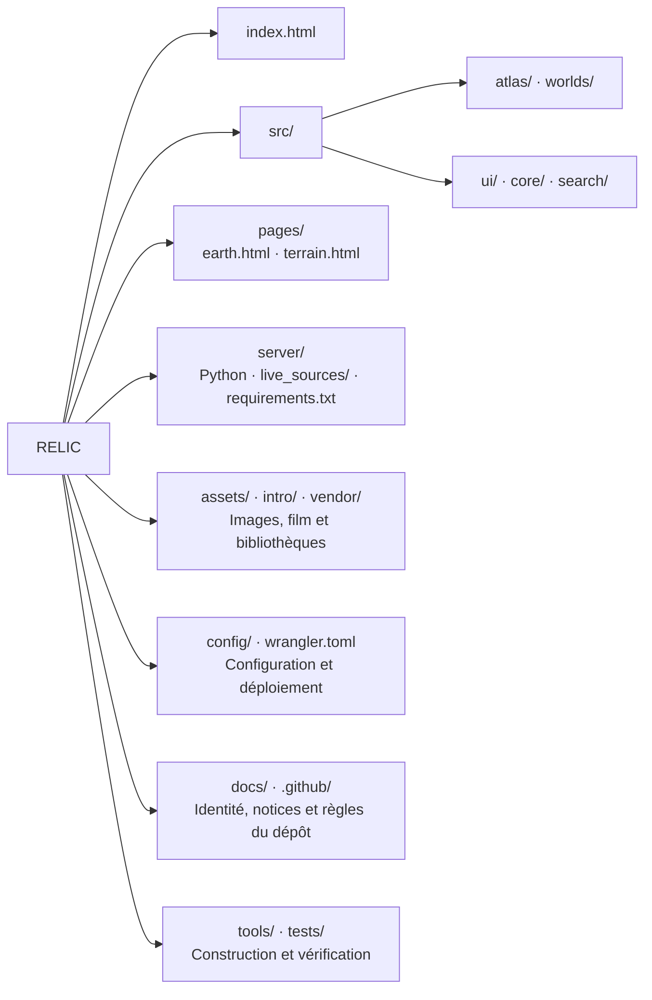

# RELIC

**An open-source journey through the Solar System and the traces of space exploration.**

RELIC combines an interactive Solar System atlas, detailed views of Earth, the Moon and Mars, and a bilingual documentary introduction. Explore measured terrain, follow the history behind missions, and help improve the project through ideas, issues and pull requests.

The original application code is available under the [Apache License 2.0](LICENSE). Third-party libraries, scientific datasets, imagery, music and archival film retain their own licenses; see [Third-party notices](docs/legal/THIRD_PARTY_NOTICES.md). RELIC is an independent project and does not imply endorsement by the organizations whose data it uses.

## Carte du projet

Vue des sources versionnées. Les médias et les bibliothèques sont regroupés pour garder la carte lisible.



<details>
<summary>Arborescence détaillée — médias et bibliothèques regroupés</summary>

```text
RELIC/
├── index.html  # Point d'entrée
├── README.md  # Présentation et carte du projet
├── src/
│   ├── atlas/  # Système solaire et données orbitales
│   │   ├── app.js
│   │   ├── atlas-live.js
│   │   ├── atlas-presentation.css
│   │   ├── compact.css
│   │   ├── live.css
│   │   ├── nasa-worlds.js
│   │   ├── orbital-data.js
│   │   ├── premium.css
│   │   ├── relic-shell.css
│   │   ├── styles.css
│   │   └── surface-detail.js
│   ├── core/  # Configuration et services
│   │   ├── api-config.js
│   │   ├── atlas-services.js
│   │   ├── google-3d.js
│   │   ├── google3d.css
│   │   ├── paths.js
│   │   └── world-bridge.js
│   ├── search/  # Recherche de lieux et coordonnées
│   │   ├── coordinateParser.js
│   │   ├── place-search.css
│   │   └── place-search.js
│   ├── ui/  # Interface, dialogues et styles
│   │   ├── api-settings.css
│   │   ├── api-settings.js
│   │   ├── app-settings.css
│   │   ├── app-settings.js
│   │   ├── app-sources.css
│   │   ├── app-sources.js
│   │   ├── branding.css
│   │   ├── interaction-motion.css
│   │   ├── navigation.css
│   │   ├── navigation.js
│   │   ├── planet-dashboard.css
│   │   ├── planet-dashboard.js
│   │   ├── provider-credits.css
│   │   ├── provider-credits.js
│   │   ├── theme.css
│   │   ├── theme.js
│   │   ├── view-loading.css
│   │   ├── view-loading.js
│   │   ├── world-icons.js
│   │   └── world-ui.js
│   └── worlds/  # Vues Terre, Lune et Mars
│       ├── earth-imagery.js
│       ├── earth-terrain.js
│       ├── earth-view.js
│       ├── earth.css
│       ├── relic-worlds.css
│       ├── terrain-globe.js
│       ├── terrain-view.js
│       ├── terrain.css
│       └── world-performance.js
├── pages/
│   ├── earth.html
│   └── terrain.html
├── server/  # Serveur Python et dépendances
│   ├── __init__.py
│   ├── __main__.py
│   ├── earth_surface.py
│   ├── live_sources/
│   │   ├── __init__.py
│   │   ├── cache.py
│   │   ├── horizons.py
│   │   └── noaa_swpc.py
│   ├── place_search.py
│   ├── planetary_patches.py
│   ├── requirements.txt
│   └── terrain_server.py
├── intro/
│   ├── assets/  # Film, pistes audio, sources et licences
│   ├── film-bridge.css
│   ├── film-bridge.js
│   ├── film-cache.js
│   ├── film-offline.js
│   ├── film-stream-v7.js
│   ├── prologue-data-v8.js
│   ├── prologue-ending-v9.css
│   ├── prologue-player.css
│   ├── prologue-typing.css
│   ├── prologue-typing.js
│   ├── prologue-v8.css
│   └── prologue-v8.js
├── assets/  # Images, manifeste et reliefs
├── vendor/  # Bibliothèques tierces et licences
├── config/
│   └── .env.example  # Modèle de configuration sans valeur personnelle
├── docs/
│   ├── BRANDING.md
│   └── legal/  # Notices et attributions conservées
│       ├── NOTICE
│       └── THIRD_PARTY_NOTICES.md
├── .github/
│   ├── CONTRIBUTING.md
│   └── SECURITY.md
├── tools/
│   ├── build_runway_assets.py
│   ├── build_static.mjs
│   ├── build_terrain_assets.py
│   ├── film/  # Production du documentaire
│   ├── restore_film.mjs
│   └── restore_film.py
├── tests/
│   ├── test_api_config.mjs
│   ├── test_earth_surface.py
│   ├── test_film_parts.py
│   ├── test_film_recovery.mjs
│   ├── test_live_sources.py
│   ├── test_place_search.py
│   ├── test_planetary_patches.py
│   ├── test_project_layout.mjs
│   ├── test_static_data.mjs
│   ├── test_static_server.py
│   ├── test_terrain_requests.mjs
│   └── test_worker_cache.mjs
├── LICENSE  # Licence du code original
├── sw.js  # Service worker : portée sur toute l’application
├── wrangler.toml  # Déploiement Cloudflare
├── .gitignore  # Exclusions Git
└── .nojekyll  # Publication GitHub Pages
```

</details>

`index.html` reste à la racine. `sw.js` garde sa portée sur toute l’application et `wrangler.toml` reste au point d’entrée du déploiement. Les fichiers générés (`dist/`, `.venv/` et les caches Python) ne sont pas versionnés.

Le code navigateur est regroupé par fonction dans `src/`, avec les styles près des composants. Utiliser `appURL()` dans `src/core/paths.js` pour construire les adresses des pages, des ressources et de l’API depuis une sous-page ; les chemins fonctionnent aussi sous un préfixe tel que `/RELIC/`. Les médias du film restent sous `intro/assets/`.

Le serveur démarre depuis la racine avec `python -m server`. La construction statique avec `node tools/build_static.mjs` produit `dist/` sans embarquer le serveur, les tests, la configuration locale ou l’environnement de développement. Chaque édition conserve sa propre configuration de fournisseur dans `src/core/api-config.js`.

## Explore

- Move between the eight planets, the Moon and the Sun in one responsive dashboard, with a persistent search field, a world selector, grouped controls and a collapsible information panel.
- Explore Earth with Cesium, satellite imagery and NASA SRTM elevation; optional Google Photorealistic 3D Tiles use your own Cesium ion token.
- Inspect global Mars MOLA and lunar LOLA terrain, with local HiRISE and LROC datasets around selected destinations.
- Search Earth locations through public geocoding services or enter latitude and longitude on any world. Packaged NASA imagery keeps the globes usable when remote layers are unreachable; generated terrain tiles require the Python server.
- Watch the English or French introduction, with sound, captions and playback controls. Historical recordings and illustrative reconstructions are identified in the film sources.

Sizes and orbital distances are adapted for readability. On static hosting, planetary positions use the labelled JPL approximate orbital model; the Python server can provide Horizons ephemerides. Neither represents spacecraft telemetry. NOAA solar-wind measurements describe conditions near Earth. Terrain and imagery have finite, source-dependent resolution; enlarging them does not create new measured detail.

## Run locally

Use Python 3.10 or newer. Node.js 22 or newer is recommended for the static build and JavaScript checks.

```sh
git clone https://github.com/Jul1-art/RELIC.git
cd RELIC
python3 -m venv .venv
. .venv/bin/activate
python3 -m pip install -r server/requirements.txt
python3 -m server
```

The current 9-minute 29-second film is delivered as local HLS segments at 1920 × 1080 and 50 frames per second, with English and French audio. Playback uses browser-native HLS or the bundled HLS player. The offline action saves and verifies the complete bilingual segmented edition. Older MP4 transport parts remain in source history but are not the active HD edition.

Open **http://localhost:8000/**. On Windows, use the corresponding virtual-environment activation command and `python` if `python3` is unavailable.

Run `python -m server` for the complete experience. A generic static HTTP server does not implement the generated elevation, live-data or place-search endpoints. Some upstream terrain products are large and are downloaded on first use, then reused from the server cache. External imagery, geocoding and current data require a network connection.

To choose a different port, set `NASA_ATLAS_PORT` before starting the server. For example:

```sh
NASA_ATLAS_PORT=8080 python3 -m server
```

### Enable current JPL data

The NASA/JPL, NOAA and public NASA imagery paths used here do **not** require a NASA API key. Automated JPL requests require a real contact in the server's `User-Agent`, according to the [JPL API policy](https://ssd-api.jpl.nasa.gov/doc/index.php).

1. Copy `config/.env.example` to `.env`.
2. Set `NASA_ATLAS_CONTACT` to your own public HTTPS contact page or contact address.
3. Load that file in the server's environment before starting Python. The server does not automatically load `.env`.

On a POSIX shell:

```sh
set -a
. ./.env
set +a
python3 -m server
```

The contact is a server setting, not an API key, and is not saved by the browser's key panel. With no valid contact configured, the app uses available cached positions with their timestamps or reports that current data is unavailable instead of sending anonymous JPL requests.

## Bring your own API keys

Open **Settings / API keys** to see the services used by the app. Paste your own browser token and choose **Save locally**. The panel also lets you forget a saved token. Local settings belong to that browser and origin; they are not committed to this repository or shared with other users.

| Service | Required? | How to configure it |
| --- | --- | --- |
| Cesium ion | Optional, for Google Photorealistic 3D Tiles | Create your own account and token at [Cesium ion Tokens](https://ion.cesium.com/tokens), enable access to the relevant imagery asset, then save the token in the app. |
| NASA/JPL, NOAA and public NASA Trek/GIBS data | No API key for the implemented endpoints | Keep the default sources. Configure the separate server contact above for JPL requests. |
| Google Cloud API key | Not used by this integration | The optional Google 3D layer is accessed through Cesium ion. No separate Google Cloud key is requested by RELIC. |

Use a browser-facing, read-only Cesium token restricted to your deployment's allowed origins. It is stored in the browser and sent to the provider when tiles are requested; browser storage is not encrypted secret storage. Do not enter account administration credentials. [Cesium's plans and quotas](https://cesium.com/platform/cesium-ion/pricing/) and [Google 3D integration terms](https://cesium.com/learn/cesiumjs-learn/cesiumjs-photorealistic-3d-tiles/) apply. NASA imagery and the basic atlas remain usable without that optional token, subject to source availability.

## Build and deploy

The Python server serves the application directly, without a frontend compilation step. Use HTTPS and an appropriate reverse proxy for a hosted installation that needs the Python data endpoints.

For a static deployment:

```sh
node tools/build_static.mjs
```

Publish the resulting `dist/` directory. A static host serves the interface, bundled assets and browser-accessible external layers; it does not execute Python. In particular, `/api/height`, `/api/live/atlas`, `/api/places` and `/api/imagery/moon/tycho` are unavailable unless you separately deploy and route a compatible backend. The browser uses available imagery, an unmeasured ellipsoid, labelled orbital-model estimates, timestamped public NOAA readings and browser geocoding when the Python endpoints are absent. The optional Cesium layer still uses the token configured in the browser.

Third-party tile services may restrict redistribution, caching or offline use. Keep their on-screen attributions and review their terms before changing how assets are served.

## Checks

```sh
python3 -m unittest discover -s tests -v
node --experimental-vm-modules --test tests/*.mjs
node tools/build_static.mjs
```

Live JPL tests may be skipped when no contact is configured. For visual changes, also check portrait and landscape phone layouts, keyboard interaction, the NASA-only rendering path and the optional-token path.

## Contribute

Everyone is welcome to propose improvements, suggest missions or datasets, report bugs and submit pull requests. Start with [Contributing](.github/CONTRIBUTING.md). Include reliable references for scientific additions and keep measured data, approximations, historical imagery and fictional simulations clearly distinguished.

Do not include personal tokens, service-account files or other credentials in issues, screenshots, example configuration or commits. See [Security](.github/SECURITY.md) for reporting guidance.

## License and credits

Original RELIC source code and original interface artwork are licensed under **Apache 2.0**. Preserve [NOTICE](docs/legal/NOTICE) and the notices that accompany bundled dependencies.

The documentary and other third-party media are **not relicensed as Apache 2.0**. They combine NASA and other archives, ESA material, CC-BY media, Pixabay material and the score **“Helios” by Scott Buckley, CC-BY 4.0**. Their source credits, modifications and individual terms remain applicable. Review [THIRD_PARTY_NOTICES.md](docs/legal/THIRD_PARTY_NOTICES.md) and the film's source manifest before redistributing, replacing or repurposing those media. The original source recordings and large intermediate rendering files are not included.

## Guide rapide en français

RELIC est un projet open source ouvert aux idées, signalements et contributions de toutes et tous. Le code original est sous licence Apache 2.0 ; les médias et bibliothèques tiers conservent leurs propres conditions.

Installez Python et les dépendances indiquées plus haut, puis lancez `python3 -m server` et ouvrez `http://localhost:8000/`. Le mode NASA de base n'exige aucune clé API. Pour les données JPL actualisées, renseignez votre propre contact public côté serveur. Pour Google 3D, ajoutez votre jeton Cesium ion dans **Réglages → Clés API** et enregistrez-le localement. Ne publiez aucune clé dans Git.

Une publication statique reste possible avec `node tools/build_static.mjs`, mais elle n'exécute pas les routes Python de relief, de recherche et de données actualisées.


## Film player

The English/French introduction opens paused and loads its video only after **Play**. The export is 1080p50; original HD material is retained where available, while older archives are upscaled and their frame rates resampled. This does not create missing archival detail. The monochrome player includes a full-width timeline, captions, playback speed and volume adjustable in 1% steps or by entering an exact percentage in the player settings. Click or tap the picture to play or pause. Portrait video is centered without cropping. Opening and closing Sources or the offline dialog keeps playback paused.

Use the **EN / FR** control to change the narration and captions during the film. The switch keeps the current position, playback state, speed and volume. Controls fade automatically during playback and reappear on interaction.

The historical sequence includes a longer music-only passage with Yuri Gagarin, Enterprise aboard its Boeing 747 carrier in 1977, the final Shuttle landing in 2011, Soyuz transport to the International Space Station, and Rosetta’s final descent in 2016. Dates distinguish the events described from later archive or visualization footage.

Keyboard shortcuts work while the film is open, outside editable fields and other dialogs. Press **?** for the in-player reference.

| Key | Action |
| --- | --- |
| Space / K | Play or pause (Space activates a focused button) |
| F | Fullscreen |
| M / C | Mute / captions |
| J / L | Back / forward 10 seconds |
| Left / Right | Back / forward 5 seconds |
| Up / Down | Volume up / down 5% |
| 0–9 | Seek to 0–90% |
| Home / End | Beginning / end |
| , / . | Previous / next frame while paused |
| < / > | Playback speed down / up 0.25× |
| Escape | Close the player menu or exit fullscreen |

## Interface and static hosting

Hold **Ctrl and drag with the left mouse button** to pan the Solar System, including its overview. Ordinary left-drag orbits, the mouse wheel zooms, and touch gestures remain available.

Earth, Moon and Mars share a responsive command bar, location search and compact Font Awesome controls. Button hover states use stationary color, border and brightness transitions. Settings include English/French, light/dark appearance, an optional NASA-blue accent, motion preferences and adaptive/high rendering quality. Preferences apply across pages.

GitHub Pages serves static files and cannot run the Python API. The browser detects that mode, avoids missing `/api` requests and falls back to clearly labelled NASA/JPL model positions, timestamped NOAA solar-wind observations, public geocoding, local destinations and coordinates. Model values are estimates, not telemetry; expired measurements are omitted. Without a terrain backend, the globe is an unmeasured ellipsoid with imagery. Optional Google 3D remains a separate provider layer.

Build with `node tools/build_static.mjs` and publish only `dist/`; the build includes the current HD HLS edition and omits retired film assets. A custom GitHub Pages workflow must use **Settings → Pages → Source: GitHub Actions**. Branch/Jekyll publication serves the source tree without that build. GitHub Pages can still impose host-level IP or bandwidth limits; the application reduces request bursts, reuses cached modules and honours `Retry-After`, but cannot disable the hosting service’s protection.
